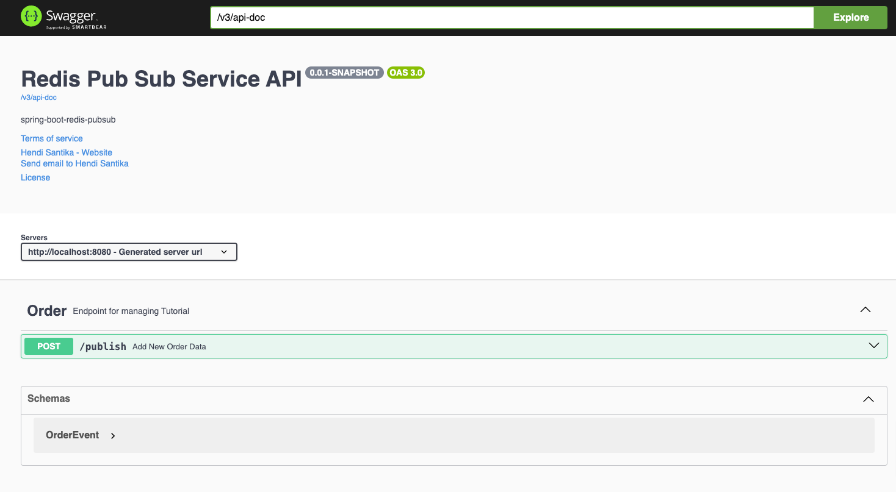

# spring-boot-redis-pubsub

[](https://github.com/hendisantika/spring-boot-redis-pubsub/actions/workflows/maven.yml)


Sample application that demonstrates **Redis Pub/Sub** with Spring Boot. An order event is published to a Redis
channel through a REST endpoint, then consumed by a `MessageListener` that stores the event back into Redis.

## Tech Stack

| Component        | Version / Library                                  |
|------------------|----------------------------------------------------|
| Java             | 25                                                 |
| Spring Boot      | 4.1.x                                              |
| Redis client     | Spring Data Redis + Jedis                          |
| JSON             | Jackson 3 (`GenericJacksonJsonRedisSerializer`)    |
| API docs         | springdoc-openapi (Swagger UI)                     |
| Testing          | JUnit 5, Mockito (`@MockitoBean`), Testcontainers  |
| Build            | Maven Wrapper                                      |

## How It Works

```
POST /publish ──► OrderService ──► Redis channel "order-events" ──► OrderEventListener ──► Redis key <orderId>
```

1. `DemoController` receives an `OrderEvent` and calls `OrderService#publish`.
2. `OrderService` sends the event to the `order-events` channel (configurable via `redis.pubsub.topic`).
3. `OrderEventListener` subscribes to the channel, deserializes the message, and saves it with the `orderId` as key.

## Prerequisites

- JDK 25
- Docker (for the local Redis container and integration tests)

## Things todo list

1. Clone this repository: `git clone https://github.com/hendisantika/spring-boot-redis-pubsub.git`
2. Navigate to the folder: `cd spring-boot-redis-pubsub`
3. Run the application: `./mvnw clean spring-boot:run`

   Redis is started automatically from `compose.yml` thanks to `spring-boot-docker-compose`.
   You can also start it manually: `docker compose up -d`
4. Open your favorite browser: http://localhost:8080/swagger-ui

## Configuration

Main properties in `src/main/resources/application.properties`:

| Property                  | Default          | Description                |
|---------------------------|------------------|----------------------------|
| `server.port`             | `8080`           | HTTP port                  |
| `spring.data.redis.host`  | `localhost`      | Redis host                 |
| `spring.data.redis.port`  | `6379`           | Redis port                 |
| `redis.pubsub.topic`      | `order-events`   | Pub/Sub channel name       |
| `springdoc.swagger-ui.path` | `/swagger-ui`  | Swagger UI path            |

## Running Tests

Integration tests spin up a real Redis via Testcontainers, so Docker must be running:

```shell
./mvnw clean verify
```

## CI/CD & Dependency Updates

- **GitHub Actions** (`.github/workflows/maven.yml`) builds and tests the project with Temurin JDK 25 on every push and
  pull request to `main`.
- **Dependabot** (`.github/dependabot.yml`) checks weekly for updates of Maven dependencies (grouped: Spring Boot,
  Spring, springdoc, testing, Maven plugins), GitHub Actions, and Docker Compose images.

## Image Screenshot

Swagger UI



Curl

```shell
curl -X 'POST' \
  'http://localhost:8080/publish' \
  -H 'accept: application/json' \
  -H 'Content-Type: application/json' \
  -d '{
  "orderId": "ORD0001",
  "userId": "USER0001",
  "productName": "Buku Sinar Dunia",
  "price": 5000,
  "quantity": 10
}'
```

Check the stored value in Redis:

```shell
docker compose exec cache redis-cli GET ORD0001
```
